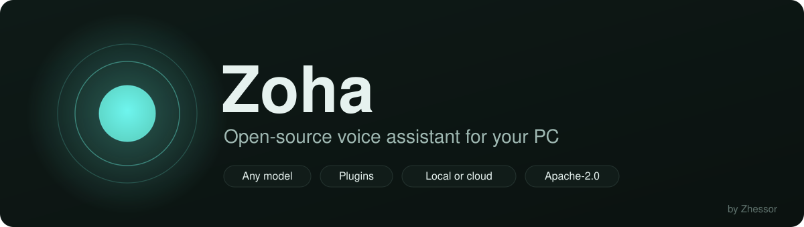
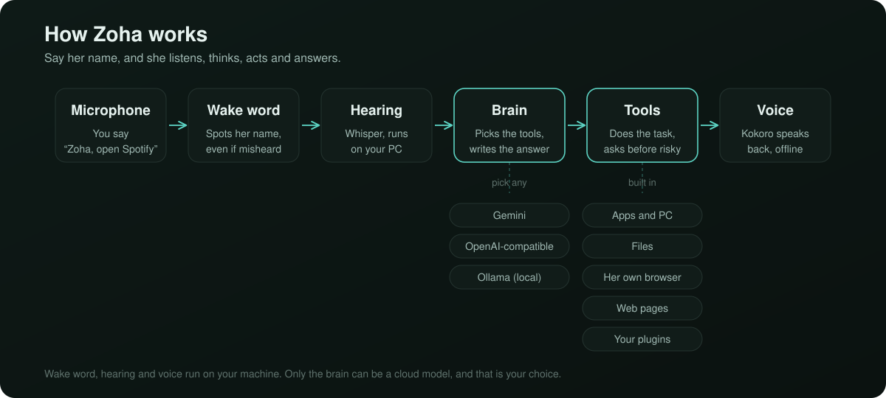
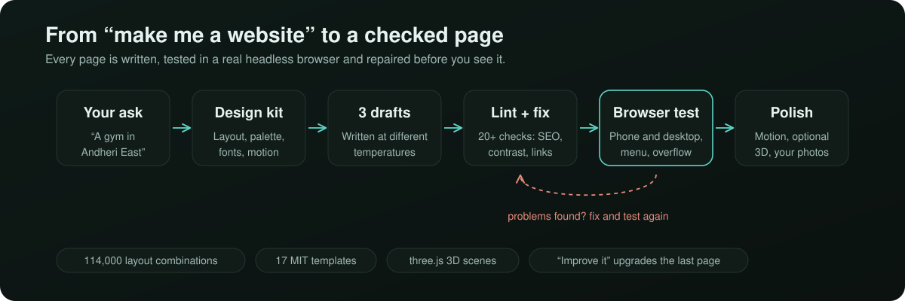
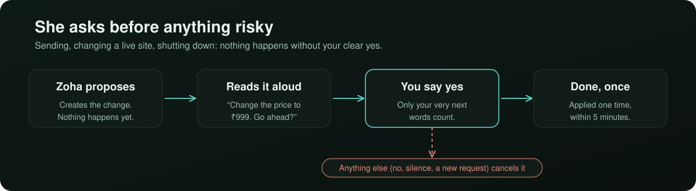

<p align="center"></p>

<p align="center">
  <a href="https://github.com/zhessor/zoha/actions/workflows/ci.yml"></a>
  <a href="LICENSE"></a>
  
  
</p>

# Zoha — an open-source voice assistant for your Windows PC

Zoha is a desktop assistant you talk to. Say **"Zoha, …"** and she opens apps, plays music, finds and
opens files, browses websites in her own browser, writes documents and full web pages, remembers
things about you, and answers questions in a natural voice.

She is **model-agnostic**. Plug in Gemini, any OpenAI-compatible API (OpenAI, OpenRouter, Groq,
LM Studio…) or any local Ollama model. Small local models keep everything offline. Bigger models give
much better multi-step work and writing.

Made by [Zhessor](https://zhessor.com). Licensed under Apache-2.0.

---

<p align="center"><br><sub>30-second illustrative demo. <a href="https://raw.githubusercontent.com/zhessor/zoha/main/docs/demo/zoha-demo.mp4">Download the MP4</a>. Source: <code>docs/demo/make_video.py</code></sub></p>

## Quick start (Windows 10/11, Python 3.12+)

```powershell
git clone https://github.com/zhessor/zoha.git
cd zoha
powershell -ExecutionPolicy Bypass -File setup.ps1   # makes the venv, installs everything, asks which brain to use
.\venv\Scripts\python.exe gui.py                    # desktop app (python main.py --text = terminal, keyboard only)
```

Prefer to do it by hand? `python -m venv venv`, activate it, `pip install -r requirements.txt` (add `-r requirements-gpu.txt`
for an NVIDIA GPU), `python setup_wizard.py`, then `python diagnostics.py --mic` to check your mic, GPU, brain and voice.

### Choosing a brain

| Option | Good for | Set in `.env` |
|---|---|---|
| Gemini | Best quality for free (with limits) | `LLM_PROVIDER=gemini`, `GEMINI_API_KEY` |
| OpenAI-compatible | Any hosted model you already pay for | `LLM_PROVIDER=openai`, `LLM_BASE_URL`, `LLM_API_KEY`, `LLM_MODEL` |
| Ollama (local) | Offline and private | `LLM_PROVIDER=local`, `LOCAL_LLM_MODEL` |

`LLM_FALLBACK=local` switches to your Ollama model when the cloud is down or out of quota.
For local use, 4B models handle simple commands. **8B–14B or larger are much better** for
multi-step tasks and writing. `python bakeoff.py` scores the models you have on 40 real commands.

## How it works

<p align="center"></p>

## What Zoha can do

- **Apps and PC:** open and close apps, volume and media keys, screenshots, live CPU/RAM/GPU/battery,
  lock. Sleep, shutdown and restart always ask first.
- **Music and live info:** play YouTube directly, Spotify search, weather, news, web lookups (summarised, not read out raw).
- **Files:** find files by spoken name ("gym underscore website dot html", sound-alikes like *jim → gym*),
  numbered listings ("open number 2"), quick notes.
- **Writing:** documents, emails, proposals, social posts and blogs, using the skills in `skills/`.
- **Web pages:** complete single-file sites. Each one uses a design kit (114k layout combinations), 17 MIT
  Bootstrap templates, optional three.js 3D, motion, and SEO basics. Every page is checked in a headless browser and
  repaired automatically. "Improve it" upgrades the page she just made.
- **Her own browser (Playwright):** shopping research, reading pages, filling forms. She asks before submitting anything.
- **Memory:** "remember that …" / "forget …". Stored locally in `data/memory.json`.
- **Typing and clipboard:** dictate short text into any window, read or copy the clipboard.

### How web pages get built

<p align="center"></p>

## Extending Zoha

### Plugins (the easy way to add tools)
Drop a `.py` file into `plugins/` and it loads at start. See [`plugins/README.md`](plugins/README.md)
and the example `plugins/coin_and_dice.py`. **New plugins are very welcome as pull requests.**

### Website / CMS plugin
Zoha can manage your own website (content, enquiries, email replies, analytics, undo) if the site exposes
a small Agent API. Every change is read out and needs your **yes**. The spec is in
[`docs/site-agent-api.md`](docs/site-agent-api.md). It's off unless `SITE_API_URL` and `SITE_API_KEY` are set.

### Skills
`skills/*.md` are the briefs Zoha follows for web pages, code, emails, proposals, social posts and blogs. Add one from a link: `python -m zoha.skill_install install <url>`.
Edit them to change her style.

## Fine-tuning your own model (optional)

`train/` and `kaggle/` contain the full pipeline used to fine-tune Zoha's own model on free Kaggle GPUs:
1. A teacher notebook generates examples.
2. `build_dataset.py` cleans and filters them.
3. A LoRA training notebook trains the model, with resume support.
4. `fix_gguf.py` makes the result loadable in Ollama.
5. `install_model.py` and `compare.py` install it and score it against the base model.

See [`train/README.md`](train/README.md). **No training data is included.** Generate your own from your own usage.

## Safety: she asks first

<p align="center"></p>

## Privacy

Everything Zoha learns about you stays in `data/` on your PC: memory, conversation journal, logs and
browser profile. With a local model nothing leaves your machine. With a cloud model, only the
conversation goes to that provider. `.env` and `data/` are git-ignored, so never commit them.

## Project layout

```
zoha/          core: engine, brain (LLM + tool routing), tools, speech, voice, browser, web kit
plugins/      community tools (auto-loaded)
skills/       writing and design briefs
templates/    MIT Bootstrap templates used for web pages
train/ kaggle/  optional fine-tuning pipeline
gui.py        desktop app      main.py  terminal mode
setup_wizard.py  first-run setup   selftest.py / stress_test.py / bakeoff.py  tests and model scoring
```

## Contributing

Issues and pull requests are welcome, especially new plugins, non-Indian locale defaults, and macOS/Linux
support. Run `python -m pytest` before opening a PR (about 20 seconds, no mic or GPU needed), and never include
personal data or keys in issues, logs or tests. See [CONTRIBUTING.md](CONTRIBUTING.md), [SECURITY.md](SECURITY.md) and [CHANGELOG.md](CHANGELOG.md).

## License

Apache-2.0. See [LICENSE](LICENSE) and [NOTICE](NOTICE) for third-party credits.
