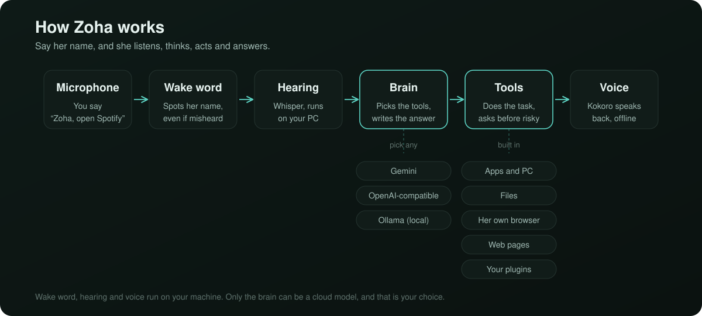

# Zoha

Zoha is a personal assistant you talk to. She opens apps, finds files, answers questions and builds web pages, and she **asks before doing anything that matters**.

[Watch the 30-second demo](demo/zoha-demo.mp4)

## What makes her different

- **Voice first.** Say "Zoha, open Spotify" or type it. Both work.
- **Builds checked web pages.** Every page she writes is linted and fixed before she shows it.
- **Asks first.** Shutdown, restart, sleep and website changes need a clear yes.
- **Your brain, your choice.** Gemini, any OpenAI-compatible API, or a local model through Ollama.
- **Open source.** Apache-2.0. Add plugins and skills as plain files.

Zoha supports Windows first. Ports to macOS and Linux are welcome.

[Install Zoha](install.md){ .md-button }
